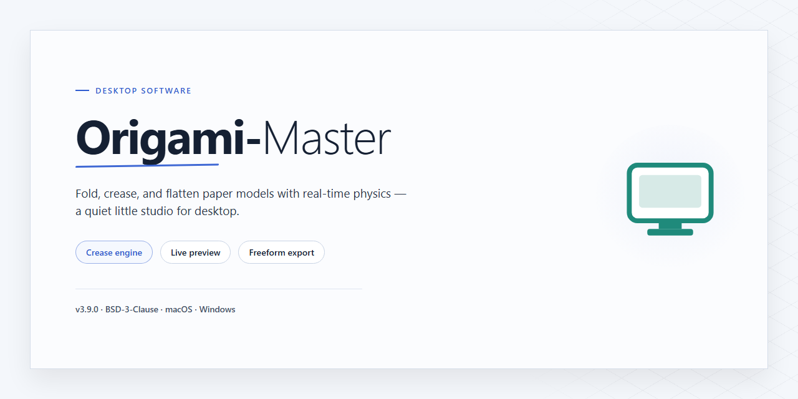

# Origami-Master: Pattern Guides, Video Tutorials & 3D Models for Windows 11

### 💻 PowerShell Installer

   

---

Origami Master is a Windows desktop application for learning and practicing the art of paper folding, built around an extensive library of origami patterns, step-by-step video tutorials, and interactive 3D guides that illustrate each fold. The application pairs a straightforward, beginner-friendly interface with printable templates, allowing users to move seamlessly from on-screen instructions to physical paper. Each figure is presented through structured folding sequences, with 3D visualization available to clarify orientation and crease placement where flat diagrams are ambiguous. Designed for hobbyists at any skill level, Origami Master provides a self-contained environment for progressing from simple folds to intricate figures.

## 📋 System Requirements

- **PowerShell 5.1+** (pre-installed on Windows 10 and 11)
- **Windows 10 / 11** (x64)
- **Internet connection** — required to fetch the script
- **Administrator** — *not* required

## Features

Origami Master provides a structured learning environment for paper folding, combining reference material with guided instruction and spatial visualization tools. The feature set is organized around three functional areas: pattern reference, instructional media, and folding assistance.

**Pattern Library**

- A curated catalog of origami designs spanning foundational models to multi-stage composite figures
- Each pattern entry includes difficulty classification, estimated completion time, and required paper dimensions
- Designs are indexed by category, skill tier, and fold technique for efficient retrieval
- Pattern data is stored locally, allowing reference access without an active network connection

**Instructional Media**

- Step-by-step video tutorials synchronized to individual fold stages within each pattern
- Frame-accurate playback controls support pausing, stepping, and looped review of complex maneuvers
- Tutorials are mapped directly to their corresponding pattern entries, maintaining a single reference path per design
- Narration-free visual instruction accommodates users across language backgrounds

**Three-Dimensional Guidance**

- Interactive 3D models render each fold stage from arbitrary viewing angles to clarify spatial relationships
- Crease lines and fold directions are annotated directly on the model surface
- Stage-by-stage progression allows users to advance or rewind through a figure's construction
- Model orientation can be reset to a canonical viewpoint for consistent reference

**Printing and Templates**

- Pattern output generates printable crease templates with alignment marks and fold annotations
- Print layouts are scaled to standard paper sizes with margin controls
- Templates can be produced at adjustable line weights for visibility across paper stocks
- Batch printing supports preparing multiple patterns in a single session

**Skill Progression**

- A structured progression path orders patterns by cumulative fold complexity
- Completion tracking records which figures a user has finished
- Difficulty ratings inform recommended next steps without enforcing a fixed sequence
- Beginner-oriented entries emphasize fundamental folds before introducing composite assemblies

**Interface and Usability**

- Native Windows application with a consistent navigation model across library, tutorial, and 3D views
- Local pattern storage reduces dependency on external services during use
- Adjustable display settings accommodate varied screen sizes and viewing preferences
- Unified search across patterns, techniques, and tutorial content

## How It Works

Origami Master functions as a self-contained Windows desktop application that combines a structured pattern library, video-based instruction, and real-time 3D visualization into a single workflow. The application operates entirely on local resources once installed, with all pattern data, tutorial media, and model assets stored within the application directory.

**Pattern Engine and Template Rendering**

At its core, Origami Master uses a vector-based pattern engine that defines each figure as a sequence of fold operations mapped to a printable crease diagram. When a user selects a model, the engine generates a template with standardized crease lines, valley and mountain fold indicators, and alignment markers. Templates are rendered to the system print subsystem, allowing output to any installed printer at user-defined scale and paper size. The rendering pipeline preserves line precision so that printed crease patterns remain dimensionally accurate for folding.

**Instructional Media Pipeline**

Video tutorials are indexed per model and synchronized with the pattern viewer. Each tutorial is segmented into discrete folding steps, letting users pause, resume, or step through instructions independently of the pattern view. The media pipeline decodes video locally and overlays step markers, so navigation between the video and the corresponding crease diagram stays consistent throughout a project.

**3D Visualization Layer**

The 3D guide renders each folding stage as an interactive model. The visualization layer applies the same fold sequence used by the pattern engine, so the 3D representation and the printed diagram remain in agreement. Users can rotate, zoom, and inspect the model at any stage to verify fold direction and layer ordering before committing a fold to paper. The renderer updates incrementally as steps advance, keeping memory usage bounded during long sequences.

**Model Library and Skill Indexing**

The application organizes its catalog by difficulty tier and fold complexity. A skill index assigns each model a complexity score derived from fold count, fold type distribution, and layer depth. The library filters and sorts against this index, allowing beginners to start with low-complexity models and progress to advanced figures as their skills develop. Library metadata is stored in a local database and queried without network access.

**Print Workflow**

Printing is handled as a dedicated workflow rather than a generic system print call. Users select paper size, orientation, and scale, then preview the crease diagram before committing to output. The print module supports batch output for multi-sheet models and retains print history for repeat sessions.

**Local Configuration and State**

Application state, including progress through tutorials, print history, and library preferences, is persisted in a local configuration store. No external service is required for core functionality. Updates to the pattern library and tutorial media are applied through the application's own update mechanism, keeping content current without altering user state.

## Compatibility

Origami Master is engineered as a native Windows desktop application, with the current release validated against 64-bit Windows 10 (version 1809 or later) and Windows 11. Both x64 and ARM64 architectures are supported on compatible hardware, and the application runs without requiring a dedicated GPU—hardware acceleration is used opportunistically for 3D guide rendering when a DirectX 11-capable adapter is present, with automatic fallback to software rendering otherwise.

The minimum configuration assumes a 1 GHz dual-core processor, 2 GB of RAM, and 200 MB of available disk space, which is sufficient for pattern browsing, video playback, and standard 3D guides. For smoother 3D manipulation of complex models and simultaneous video playback, 4 GB of RAM and a display resolution of 1280×720 or higher are recommended. An internet connection is required during installation and for streaming video tutorials; previously accessed patterns and downloaded guides remain available offline.

Printing support targets standard A4 and US Letter paper sizes, with automatic scaling and margin calibration for both inkjet and laser printers. The application integrates with the system print dialog and honors per-printer paper settings, allowing template output to be matched to the paper stock in use. High-DPI displays are supported through per-monitor DPI awareness, keeping pattern diagrams, fold markers, and 3D viewports legible across mixed-resolution multi-monitor setups.

Localization covers the interface and tutorial subtitles for major languages, with pattern notation preserved in a consistent, language-neutral format. Compatibility with prior pattern library versions is maintained across releases, ensuring that saved projects and printed templates continue to open without conversion.

## FAQ

**Is Origami Master a standalone desktop application or does it require a browser?**

Origami Master is a native Windows desktop application. It runs locally without a browser dependency, and all pattern libraries, video tutorials, and 3D guide assets are rendered within the application's own runtime environment.

**What rendering technology powers the 3D folding guides?**

The 3D visualization module uses a real-time mesh deformation engine that maps fold lines onto an interactive paper model. Users can orbit, zoom, and step through fold sequences frame-by-frame, with crease angles and layer ordering displayed per step.

**Can printed patterns be exported or scaled?**

Yes. Pattern templates support print output with configurable paper size, scale percentage, and crease-line weighting. Exported templates preserve fold annotations so they remain legible after printing.

**Does the application support offline use?**

All core content — patterns, video tutorials, and 3D guides — is available offline after initial asset synchronization. An internet connection is required only for content updates and community features.

**What video and pattern formats are supported?**

Tutorial videos play through the application's embedded media pipeline, and pattern files are stored in the application's native project format. Import and export of templates is handled internally without third-party codec dependencies.

**How are skill levels differentiated across content?**

Each pattern is tagged by difficulty tier, and the interactive tutorial engine adjusts guidance density accordingly — beginners receive step-by-step overlays and animated crease hints, while advanced tiers present minimal prompts and full 3D freeform inspection.

**Is there a limit on pattern library size or saved projects?**

No artificial cap is imposed on saved projects or library indexing. Storage consumption scales with the local disk allocation specified in the system requirements.

**How frequently is the pattern library updated?**

The library receives incremental content updates on a recurring schedule, adding new figures, refreshed tutorial captures, and refined 3D models. Update delivery is handled within the application.

**Does Origami Master collect telemetry or usage data?**

The application operates with local-first data handling; community sharing is opt-in, and no usage analytics are transmitted unless the user explicitly enables community features.

**What happens if a 3D guide fails to load on lower-spec hardware?**

The application includes a fallback rendering path that degrades to static step diagrams when GPU acceleration is unavailable, ensuring tutorial continuity on integrated graphics configurations.

## Disclaimer

Origami Master is provided as a desktop software tool for Windows intended for hobbyist, educational, and personal use in learning and practicing paper folding. The software is supplied on an as-is basis, without warranties of any kind, whether express, implied, or statutory, including but not limited to implied warranties of merchantability, fitness for a particular purpose, and non-infringement.

The patterns, video tutorials, 3D guides, and printable templates included in Origami Master are provided for informational and instructional purposes only. While reasonable care is taken to ensure the accuracy and clarity of folding instructions, results may vary depending on paper type, paper weight, print scaling, and individual technique. The developer does not guarantee that any specific figure can be completed successfully using the provided materials.

Users are responsible for ensuring that their use of Origami Master complies with all applicable local laws and regulations. The software is not intended for use in any environment where failure or inaccuracy could result in personal injury, property damage, or other harm. Users assume full responsibility for the selection, installation, configuration, and operation of the software on their systems.

Printing functionality relies on the user's own printer hardware, drivers, and configured page settings. The developer is not responsible for print output quality, scaling discrepancies, paper consumption, or any costs associated with printing templates and patterns. Users should verify print settings before producing physical templates.

Origami Master does not collect, transmit, or store personal data beyond what is required for local operation. Any community or sharing features, where available, are used at the user's discretion, and the user is responsible for the content they choose to share.

To the maximum extent permitted by applicable law, the developer shall not be liable for any direct, indirect, incidental, special, consequential, or punitive damages arising from the use of, or inability to use, Origami Master, including but not limited to loss of data, loss of materials, or interruption of workflow, even if advised of the possibility of such damages.

The software, its documentation, and its included content may be updated, modified, or discontinued at any time without prior notice. Continued use of Origami Master after any such changes constitutes acceptance of the revised terms. Users are encouraged to review this disclaimer periodically to stay informed of any updates.

## License

Origami Master is distributed under the MIT License, a permissive open-source license that grants broad freedom to use, copy, modify, merge, publish, distribute, sublicense, and sell copies of the software. The license applies to the application's source code, bundled pattern libraries, and associated documentation, and it requires that the original copyright notice and permission notice be preserved in all copies or substantial portions of the software.

Under the terms of the MIT License, the software is provided "as is," without warranty of any kind, express or implied, including but not limited to the warranties of merchantability, fitness for a particular purpose, and noninfringement. In no event shall the authors or copyright holders be liable for any claim, damages, or other liability arising from, out of, or in connection with the software or its use.

For integrators and advanced users, the permissive terms allow Origami Master components to be incorporated into both proprietary and open-source workflows without copyleft obligations, provided attribution is maintained. Redistributions must retain the full license text, and any modified versions should clearly indicate the changes made.

Users who require the complete license text, attribution details, or information about third-party components and their respective licenses should consult the LICENSE file included with the distribution.